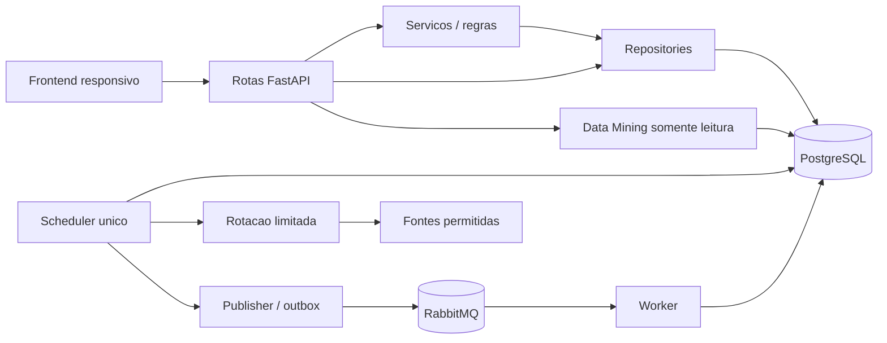

# Arquitetura profissionalizada do Hunter

Monolito modular com processos independentes, sem necessidade de dividir o TCC
em varios repositorios/microservicos. Contratos HTTP anteriores e entradas app:app
e auth.py preservados por fachadas. Nenhum acesso ao banco ou HTTP ocorre por
importar repositories/configuracao; conexoes da API pertencem ao lifespan.

```text
backend/
  main.py                fabrica e composicao
  database.py            pool e lifespan
  dependencies.py        identidade/autorizacao
  schemas.py             validacao dos contratos
  security.py            JWT e bcrypt
  errors.py              resposta segura de erros
  routes/                accounts, feedback, alerts, notifications, products
  services/accounts.py   regras de credenciais e alteracao de acesso
  repositories/          SQL parametrizado por dominio
frontend/
  *.html                 paginas nos mesmos enderecos HTTP
  assets/js/api.js        transporte e sessao compartilhados
  assets/js/ui.js         navegacao, mensagens, helpers e inicializacao
  assets/js/pages/        home, login, search, alerts, feedback, profile
  assets/js/dashboard.js  graficos e analises
  assets/css/            tema legivel e CSS legado preservado
  assets/img*/           imagens e fallback
config/                  settings e alvos de bootstrap
catalog_expansion/       candidatos, rotacao, adaptadores e heartbeat
messaging/               outbox, broker, publisher, worker e scheduler
data_mining/             leitura e metodos analiticos
scraping/                coletores/parsers, normalizacao e persistencia
ops/                     bootstrap vazio, template de privilegios e Nginx
scripts/manual/          verificacoes opt-in fora da suite automatizada
tests/                   testes isolados e navegador
```



## Mudancas e compatibilidade

- app.py e auth.py viraram fachadas pequenas; a URL de cada rota e seus parametros
  foram preservados. Teste de contrato confirma os22 pares metodo/path anteriores.
- SQL de contas, feedback, alertas, notificacoes e produtos saiu dos controllers.
  Hash/validacao de senha atual e emissao de token pertencem ao servico de contas.
- Historico deixou de fazer duas leituras redundantes quando005 esta presente.
- Consultas de catalogo para cada versao sao SQL explicito, sem encadeamento de
  substituicoes textuais. Fallback e comportamento de preco legado preservados.
- Lock comum passou a constants.py; periodic/rotation nao dependem circularmente
  um do outro para importar esse identificador.
- Frontend tem transporte/sessao centralizados e inicializadores por pagina.
  A configuracao de origem da API e compartilhada pelo dashboard. Arquivos foram
  organizados sem mudar os enderecos de navegacao; aliases preservam assets antigos.
- O servidor local so expoe paginas/assets permitidos e configuracao publica da
  origem da API. Containers usam Nginx, nao o servidor Python de desenvolvimento.

## Persistencia e limites que continuam validos

Migracoes001 a005 nao foram modificadas. Nenhum DDL/DML foi aplicado no principal.
Fontes/candidatos, IDs, imagens, observacoes e protocolos de evento foram mantidos.
Politicas de coleta, quota e seis horas continuam iguais; nenhum scraper iniciado.
Mudancas em regras de frescor, matching de SKU, aliases de URL e limites exigem
etapa especifica, caracterizacao e aprovacao, preservando historico.

Baseline de banco novo esta em ops/base_schema.sql, reutilizada pelo bootstrap
isolado. O bootstrap de producao recusa banco com tabelas e exige opt-in explicito;
ele nao deve ser confundido com migracao do principal. A divergencia email100/255
do banco existente continua pendente de uma futura migracao autorizada.

## Qualidade e operacao

Ruff usa baseline de erros estruturais/nomes indefinidos; formatacao nova aplicada
aos modulos criados sem reformatar todo o legado. check_quality verifica AST,
sintaxe JS e alguns literais sensiveis sem imprimir valores. Nao substitui scanner
de historico Git, analise de dependencias ou auditoria de seguranca.

Coverage mede linhas dos pacotes de aplicacao, sem prometer cobertura funcional
integral. E2E cobre login, CRUD, busca, fotos/fallback, historico, entrega e leitura
de notificacao e dashboard real/demo. CI usa servicos e credenciais efemeros.
O antigo CD simulado esta arquivado em docs/legacy, fora dos workflows ativos.

Preparacao de containers nao equivale a deploy Azure. API, worker e scheduler
devem receber ambiente/segredos externamente e ter supervisao. Scheduler exige
uma instancia ativa e conexao de sessao dedicada para seu lock. Worker tem retry;
supervisor deve recompor processos encerrados. Logs novos sao UTC/stdout.
