# Mineracao de precos orientada a eventos

O modulo `data_mining.streaming` complementa o dashboard exploratorio existente.
Consome eventos RabbitMQ continuamente e persiste resultados por observacao.
O K-Means e os endpoints anteriores continuam calculados sob demanda.

## Fluxo

```mermaid
flowchart LR
    Collector[Importador ou coletor autorizado] --> Observation[(Observacao PostgreSQL)]
    Observation --> Trigger[Trigger transacional]
    Trigger --> Outbox[(hunter_analytics_events)]
    Outbox --> Publisher[Publisher continuo]
    Publisher --> Queue[RabbitMQ prefix.analytics]
    Queue --> Consumer[Consumidor analitico]
    Consumer --> Results[(hunter_analytics_results)]
    Results --> API[GET /analytics/streaming]
```



Cada INSERT de observacao de fonte real gera uma entrada na outbox na mesma
transacao. Rollback desfaz ambas. Fontes demo/fixtures nao geram eventos.
As sete fontes permitidas sao as mesmas de `data_mining.repository.REAL_SOURCES`.
007 inclui as cinco fontes anteriores e 008 inclui `scrapling_browser_card` e
`scrapling_public_card`, emitidas pelos parsers atuais de lojas de tecnologia.
Novas fontes exigem migracao e atualizacao da lista Python de forma coordenada.
Nao ha varredura em lote do catalogo para descobrir novos dados: a outbox e
consultada a cada segundo para encaminhar os eventos pendentes.

A migracao 007 e o complemento 008 preservam registros anteriores e criam eventos com `replay=true`
para o historico real existente. Novas observacoes recebem `replay=false`.
Replay demonstra reprocessamento; testes isolados demonstram chegada de novos
eventos. A coleta externa nao e ativada pela instalacao deste consumidor.

## Tecnica e semantica

Janela deslizante por contagem, de ate 20 observacoes do mesmo produto/oferta,
ordenadas pelo tempo da coleta e ID, ate o evento recebido. Nao mistura lojas/SKUs.
Empates de horario usam a observacao de maior ID disponivel ate aquele evento.
O acesso e limitado pelo indice produto/data; nao carrega todo o catalogo.

O resultado armazena tamanho da janela, preco atual, media, minimo, maximo,
variacao percentual contra o ponto anterior e sinal de queda de pelo menos 5%.
Com cinco pontos anteriores e desvio padrao positivo, calcula z-score contra
esses pontos e sinaliza anomalia se seu valor absoluto atingir 3. Sem baseline
suficiente ou com variancia zero, z-score/anomalia sao nulos. Uma observacao
isolada nao produz variacao ou anomalia. Os sinais sao exploratorios; nao
comprovam oferta vigente, vantagem comercial ou capacidade preditiva.

Cada resultado e um snapshot da janela disponivel quando o evento foi processado.
Eventos atrasados usam seu proprio tempo; nao reescrevem resultados antigos de
eventos posteriores. Nao ha garantia de ordem global no RabbitMQ, nem watermark
ou revisao retroativa. Datas futuras sao recusadas pelo consumidor.

## Confiabilidade

Fila quorum duravel exclusiva `<prefix>.analytics` e DLQ `<prefix>.analytics.dead`.
Mensagens persistentes com publisher confirms. A outbox so marca publicado apos
confirmacao. Publicacoes sem resultado sao recuperadas apos a janela de recovery.
Duplicatas sao esperadas: chave primaria observation_id e lock transacional
garantem um unico resultado persistido por observacao. ACK ocorre apos commit.
Falhas de infraestrutura propagam sem ACK, reconectando o processo.

Falhas de dados possuem retry duravel limitado por HUNTER_MAX_ATTEMPTS e espera
HUNTER_RETRY_SECONDS. Apos o limite, a intencao de DLQ permanece no PostgreSQL ate
publicacao confirmada. Mensagens malformadas/desconhecidas sao colocadas em
quarentena na DLQ apenas com hash, sem copiar conteudo externo para logs.
Os eventos de alertas e sua fila `.price` permanecem separados.

## Instalar e consultar

1. Validar primeiro no ambiente isolado: `python scripts/dev.py test`.
2. Em banco existente, realizar backup protegido e aplicar explicitamente
   `python -B -m messaging.migrate --version 007` e depois `--version 008`, com MIGRATION_DATABASE_URL do
   destino correto. Nao editar migracoes ja aplicadas. Runtime com privilegios
   minimos precisa dos grants adicionados ao template ops/postgres_roles.sql.
3. Na stack dev, o bootstrap inclui 007/008 e o Compose inicia o servico `analytics`.
   Usar o arquivo de configuracao e `--instance` existentes, sem recriar segredos.
4. Fora do Compose: `python -B -m data_mining.streaming`, com as mesmas variaveis
   DATABASE_URL, RABBITMQ_URL e HUNTER_QUEUE_PREFIX dos demais componentes.
5. Consultar `GET /analytics/streaming?limite=20`, opcionalmente com produto_id.
   A rota somente le resultados persistidos; nao dispara calculo. Sem 007 retorna
   503. Swagger permite inspecionar esta rota no grupo Data Mining.

## Evidencias e metricas

Estados globais da outbox mostram pending/published/processed/dead_pending/dead.
As tabelas registram tentativas, publicacoes, tempos de coleta/publicacao/resultado
e codigo de erro sem credenciais. Logs identificam observacao e resultado.
Medir backlog, tempo entre publicacao e processamento, taxa de falhas/DLQ e
quantidade de resultados por observacao. `replay` distingue backlog historico.
Nao foi estabelecido SLA de latencia, benchmark de carga ou precisao de anomalias.

Os testes `tests/test_streaming.py` verificam calculos, contrato, janela limitada,
eventos atrasados, rollback atomico do trigger, exclusao de demo, entrega RabbitMQ,
ACK e efeito unico apos duplicata. Executar os testes de integracao somente no
banco/broker isolados, com os guards existentes. Fixtures commitadas sao
identificadas e preservadas exclusivamente no banco de testes.

## Roteiro para apresentar ao professor

1. Abrir `http://localhost:15688`, entrar com credenciais locais sem inclui-las em
   capturas, e mostrar a fila `hunter_dev.analytics` com consumidor ativo. Uma fila
   vazia com consumidor ativo pode indicar mensagens ja processadas, nao falha.
2. Abrir `http://localhost:8088/docs`, grupo Data Mining, GET /analytics/streaming,
   executar Try it out/Execute e mostrar resultados, timestamps, algoritmo e replay.
   Historico anterior a ativacao aparece como replay, nao como coleta ao vivo.
3. Para provar chegada continua, executar a demo apenas na stack isolada configurada:

```text
docker compose --project-name hunter-team-test-streaming --env-file .env.team-test.streaming.local -f compose.team-test.yaml run --no-deps runner python -B tests/demo_streaming.py
```

O script cria fixture rotulada no banco de testes, inicia o consumidor como
processo separado, insere preco 100 e depois 80, aguarda cada resultado e publica
uma duplicata. Esperado: `status=aprovado`, `eventos_novos=2`,
`resultados_persistidos=2`, `duplicata_sem_efeito=true`, ultima janela com media 90,
variacao -20 e queda detectada. Fixtures sao sinteticas, mas PostgreSQL, RabbitMQ
e consumidor sao reais. O processo de demonstracao e encerrado ao terminar.
4. Mostrar a persistencia por SQL somente leitura:

```sql
SELECT observation_id, produto_id, replay, window_size, price, mean_price,
       change_percent, drop_detected, event_time, processed_at
FROM hunter_analytics_results ORDER BY processed_at DESC LIMIT 20;
SELECT status, count(*) FROM hunter_analytics_events GROUP BY status;
```

5. Anexar saida da demo, relatorio da suite e diagrama acima. A execucao local da
   suite nao comprova CI remota; o workflow foi atualizado, mas publicacao e
   verificacao da execucao no GitHub sao etapas separadas.
