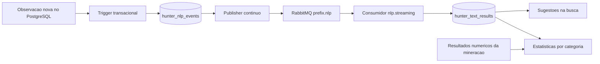

# PLN e autocomplete do Hunter

Implementado e validado em 14/11/2026 na copia local-data/Hunter-main. O texto
analisado e o nome publico das ofertas. Feedbacks privados, contas e termos
digitados na busca nao sao enviados ao broker nem gravados por este modulo.

## Processamento textual

`nlp/analysis.py` aplica limpeza de HTML, exclusao de script/style, casefold,
normalizacao Unicode, remocao de acentos, tokenizacao e stopwords em portugues.
Preserva modelos alfanumericos como G502 e conectores como USB-C. Extrai ate oito
palavras-chave por frequencia, com desempate pela primeira ocorrencia.

A classificacao tematica usa um vocabulario explicito de categorias e sinonimos,
por exemplo teclado/keyboard, headset/fone e armazenamento/SSD. Com varias classes
encontradas retorna multicategoria; sem evidencia retorna outros. O algoritmo e
`titulo-regras-pt-v1`, deterministico e explicavel. Nao e modelo treinado, analise
de sentimento, corretor ortografico, busca semantica ou classificacao de SKUs.
Precisao em corpus real rotulado ainda nao foi medida; os testes validam regras
e casos de regressao, sem estimar qualidade estatistica em producao.

Exemplo: `Teclado Mecanico para Jogos` resulta em tokens
`teclado, mecanico, jogos`, categoria `teclado` e exclusao da stopword `para`.

## Broker e integracao com mineracao



Migracao 009 cria somente tabelas, indices e trigger adicionais. As sete fontes
reais permitidas sao as mesmas das migracoes 007/008. Historico preexistente recebe
eventos replay=true; novas observacoes recebem replay=false. Fontes de fixtures
nao geram eventos automaticamente. A coleta externa continua desligada.

O consumidor `python -B -m nlp.streaming` reutiliza o mecanismo de outbox,
publicacao confirmada, ACK apos commit, retry limitado, recovery e DLQ da
mineracao. Fila exclusiva `hunter_dev.nlp`, DLQ `hunter_dev.nlp.dead`, mesmo broker
RabbitMQ. Mensagens carregam apenas version/event_id; texto e lido do PostgreSQL.
Eventos duplicados nao criam resultados adicionais. Filas de precos/alertas sao
preservadas. O Compose dev inclui o novo servico nlp.

GET /analytics/categorias agrega a ultima analise textual de cada oferta retail
e associa o resultado numerico da mesma observacao. Apresenta quantidade de
ofertas, precos analisados, variacao media disponivel e quedas detectadas. Se o
consumidor numerico ainda nao finalizou, o resultado relacionado pode estar ausente.
Nao agrupa ofertas por SKU equivalente nem interpreta ausencia de variacao como zero.

## Autocomplete e interface

Na pagina inicial e em buscar.html, a partir de dois caracteres, o JavaScript
consulta GET /sugestoes apos 220 ms sem digitacao. A API normaliza a consulta com
o mesmo pre-processamento e exige que todos os termos correspondam a prefixos
dos tokens do titulo. Limita a oito sugestoes por padrao e deduplica titulos
normalizados. Nao altera o contrato da busca livre.

Somente a ultima observacao textual processada de ofertas retail disponiveis e
considerada. Titulos acima do limite de 255 caracteres da busca existente nao sao
sugeridos. Consultas de autocomplete tem limite de 80 caracteres. Dados legados
sem observacao real datada continuam na busca anterior, mas nao sao inventados
para preencher o autocomplete. Ha consistencia eventual enquanto o broker processa.

O componente usa combobox/listbox, aria-expanded/activedescendant, anuncio de
sugestoes, setas, Enter e Escape. A selecao por clique ou teclado executa a busca.
Respostas atrasadas nao sobrescrevem a consulta atual. Falha do autocomplete nao
bloqueia o campo ou a busca. Textos sao exibidos com textContent, sem executar HTML.
Os testes de teclado e celular nao substituem auditoria completa com leitor de tela.

## Rotas e provas para a apresentacao

No Swagger em http://localhost:8088/docs:

- GET /nlp/analises: nome, texto normalizado, tokens, palavras-chave, categoria,
  algoritmo, replay e horarios persistidos. A instalacao possui 300 resultados
  historicos processados, com replay=true.
- GET /sugestoes?q=tecla: sugestoes reais derivadas do indice textual processado.
- GET /analytics/categorias: associacao entre PLN e mineracao numerica.

No painel http://localhost:15688, mostrar a fila hunter_dev.nlp com consumidor
ativo. Nao incluir credenciais em capturas. Uma fila vazia pode indicar backlog
concluido. Na interface http://localhost:8088/index.html, digitar `tecla` e mostrar
a lista, navegar com setas e confirmar com Enter.

SQL somente leitura para inspecionar persistencia:

```sql
SELECT observation_id, produto_id, normalized_text, tokens, keywords,
       category, algorithm, replay, processed_at
FROM hunter_text_results ORDER BY processed_at DESC LIMIT 10;
SELECT status,count(*) FROM hunter_nlp_events GROUP BY status;
```

## Validacao realizada

- 217 testes unitarios/integracao aprovados, sem skips; cobertura global de linhas
  83% (2965 instrucoes, 496 nao cobertas), incluindo o novo pacote nlp.
- Testes de limpeza, acentos, stopwords, sinonimos, categorias ambiguas/desconhecidas,
  modelos, palavras-chave, idempotencia, triggers atomicos, eventos fora de ordem,
  exclusao de fixtures e integracao das rotas/analises numericas.
- `tests/demo_nlp.py`: processos independentes de PLN e mineracao numerica,
  PostgreSQL e RabbitMQ reais em ambiente isolado, observacao nova replay=false,
  resultado integrado persistido e duplicata sem efeito adicional.
- `tests/browser_nlp.py`: API real, selecao por teclado, celular sem overflow,
  Escape, respostas atrasadas, XSS e indisponibilidade do autocomplete. Regressoes
  anteriores de busca, autenticacao, CRUD, alertas, dashboard e mensageria passaram.
- Verificacao somente leitura na instalacao via Nginx/Edge headless: sugestoes,
  selecao, busca e celular aprovados; capturas revisadas. nginx -t, builds, Ruff,
  sintaxe JS/Python e diff --check aprovados. O proxy ganhou as rotas nlp/sugestoes.
- Workflow CI atualizado, sem commit/push ou execucao remota comprovada nesta etapa.

Evidencias locais ignoradas em local-reports/nlp-20261114: full-suite.log,
demo-pln.json, api-pln.json, sugestoes.json, categorias.json,
autocomplete-desktop.png e autocomplete-mobile.png. A demo usa fixture sintetica
explicitamente identificada somente no banco isolado; nao e oferta comercial real.

Repetir com `python scripts/dev.py test --instance streaming`, reutilizando a
configuracao local existente. Outra maquina exige primeiro test-configure.
Para demo especifica, com servicos de teste saudaveis e imagem atualizada:

```text
docker compose --project-name hunter-team-test-streaming --env-file .env.team-test.streaming.local -f compose.team-test.yaml run --no-deps runner python -B tests/demo_nlp.py
```

## Instalacao e preservacao

Backup local privado criado antes da migracao 009; indice lido com pg_restore
--list, sem teste de restauracao completo nesta etapa. Depois da instalacao:
250 produtos, 300 observacoes, 300 resultados numericos preservados e 300 novos
resultados textuais. Nenhum scraper, alteracao do banco antigo ou fixture no banco
da aplicacao. API atualizada por copia/reinicio para preservar o navegador
efemero de coleta; frontend e consumidor nlp usam imagens novas. Proximos builds
usam o checkout e o bootstrap atualizados. Runtime com privilegios minimos precisa
dos grants adicionados ao template ops/postgres_roles.sql apos 009.

Arquivos desta etapa: nlp/{__init__,analysis,api,streaming}.py,
migrations/009_pln_catalogo.sql, frontend/assets/js/autocomplete.js,
frontend/assets/js/pages/{home,search}.js, frontend/assets/css/ui.css,
frontend/{index,buscar}.html, backend/main.py, data_mining/streaming.py,
messaging/{broker,migrate,testing}.py, ops/{bootstrap,dev_bootstrap}.py,
ops/postgres_roles.sql, ops/nginx.conf, ops/nginx.simulation.conf, compose.dev.yaml,
Dockerfile.test, pyproject.toml, scripts/{check_quality,run_team_tests}.py,
tests/{test_nlp,demo_nlp,browser_nlp}.py, .github/workflows/ci.yml, README.md,
este documento e CONTINUIDADE.md. Alteracoes da etapa anterior foram preservadas.

Referencias conceituais: [classificacao textual no livro NLTK](https://www.nltk.org/book/ch06.html)
e [padrao combobox WAI-ARIA](https://www.w3.org/WAI/ARIA/apg/patterns/combobox/),
consultados em 14/11/2026. A implementacao textual usa biblioteca padrao Python,
sem treinamento ou download de modelos.
